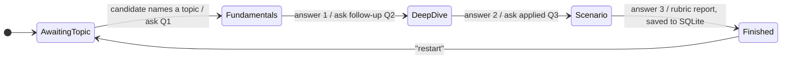

# AI Interviewer: LLM Mock-Interview Agent with a Measured Scoring Prompt

A mock technical interviewer that runs a fixed three-question interview over Discord (or a terminal client), then writes a structured score report that is stored in SQLite and browsed in a Streamlit dashboard. Personal project, 2026.

**Stack:** FastAPI · asyncio · discord.py · aiohttp · SQLite · Streamlit · Pandas · any OpenAI-compatible LLM API (default: Zhipu GLM-4-Flash, free tier)

## Problem

- Left to itself, a chat model does not run an interview. It explains answers instead of asking, keeps following up forever and never decides when to stop.
- Scores produced by an LLM judge are noisy, and it is easy to report a number that looks like an improvement but is not. Measuring the judge properly is part of the project.

## Design

The interview flow is controlled by code, not by the model. A per-user state machine decides which instruction the model receives at each turn and when the interview ends.



| Layer | File | Role |
|---|---|---|
| Interview logic | [`api/interview.py`](api/interview.py) | State machine, per-stage prompts, scoring rubric, score parsing. No I/O, so it is unit-tested with a fake LLM |
| API | [`api/main_api.py`](api/main_api.py) | FastAPI endpoint `POST /api/chat`; async LLM client; saves the final report |
| Front ends | [`bot/main_bot.py`](bot/main_bot.py), [`cli.py`](cli.py) | Discord bot (async, splits replies at Discord's 2000-character limit) and a terminal client |
| Storage | [`database/db_manager.py`](database/db_manager.py) | SQLite: full report plus parsed per-dimension scores |
| Dashboard | [`web/dashboard.py`](web/dashboard.py) | Streamlit: interview list, mean score per dimension, full reports |

Details that matter in practice:

- **A failed LLM call does not advance the interview.** The session is only updated after the model replies, so the candidate can resend the same answer.
- **The rubric is structured.** The final prompt asks for Knowledge depth /40, Logical rigour /30 and Clarity /30, and the numbers are parsed into separate database columns. A report that cannot be parsed is still saved, with NULL scores, and counted in the dashboard.
- **Bounded context.** Only the last 10 messages are sent to the model.

## Evaluating the scoring prompt

The question was whether the structured rubric scores answers better than a plain "give a score from 0 to 100" prompt. The test set ([`eval/cases.json`](eval/cases.json)) has 9 answers to one QuickSort question: 3 strong, 3 partly wrong and 3 weak. Each prompt scores each answer several times.

A good judge should give the same answer the same score on every run, keep answers of the same quality close together, and keep strong and weak answers far apart.

### First run (March 2026) and what was wrong with its conclusion

9 answers × 3 repeats × 2 prompts = 54 calls, temperature 0.7.

| | Baseline prompt | Structured rubric |
|---|:---:|:---:|
| Mean score: strong / partly wrong / weak | 83.3 / 39.4 / 14.4 | 75.8 / 50.6 / 28.9 |
| SD within tier: strong / partly wrong / weak | 5.0 / 3.9 / 15.1 | 8.7 / 5.9 / 16.0 |
| Pooled within-tier SD ↓ | **9.5** | 11.1 |
| Separation, strong minus weak ↑ | **68.9** | 46.9 |
| Separation / within-tier SD ↑ | **7.3** | 4.2 |
| SD of all 27 scores pooled | 30.4 | 22.2 |

The first write-up reported the last row: pooled SD fell by 27 %, which was read as "more stable scoring". **That reading was wrong.** The pooled SD mixes two things: noise, which should be small, and the gap between strong and weak answers, which should be large. The rubric lowered the pooled SD by squeezing the score range, not by scoring more consistently. Measured properly, the rubric was *less* consistent within every tier and separated strong from weak answers by 22 fewer points.

**Conclusion from this run:** on this test set, the structured rubric did not score answers better than the baseline. Its value in the product is the per-dimension breakdown and feedback, not better ranking.

The first run also had weaknesses that the rewritten script fixes:

- Replies whose score could not be parsed were counted as **0**, which can inflate the SD of the weak tier.
- The rubric used in the experiment was a shortened version, not the prompt the product actually uses.
- Prompts and answers were in Chinese; the current version is in English.

### Current evaluation script

[`eval/scoring_eval.py`](eval/scoring_eval.py) scores the **same rubric the product uses** (imported from `api/interview.py`), excludes and counts unparsable replies, and reports repeatability (SD across repeats of one answer), within-tier SD and separation, with pooled SD shown only for reference. Raw scores are saved as JSON in `eval/results/`.

```bash
python -m eval.scoring_eval --repeats 5
```

A sensible next step is a larger test set with several questions, and checking whether lower temperature or asking for the per-dimension scores before the total improves repeatability.

## Run it

Python 3.10+.

```bash
pip install -r requirements.txt
cp .env.example .env            # add LLM_API_KEY (and DISCORD_TOKEN for the bot)
uvicorn api.main_api:app        # terminal 1: backend
python cli.py                   # terminal 2: interview in the terminal
python bot/main_bot.py          # or: Discord bot
streamlit run web/dashboard.py  # dashboard
pytest                          # tests use a fake LLM, no API key needed
```

## Limitations

- Sessions are kept in memory, so they are lost when the API restarts, and the API runs as a single process.
- The evaluation uses one question and nine answers, which is too small for firm conclusions about the prompts.
- An LLM judge can be swayed by confident wording; the test set has only a few answers that are confident and wrong.

---
Code: [MIT](LICENSE).
