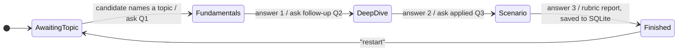

# AI Interviewer: LLM Mock-Interview Agent with a Measured Scoring Prompt

A mock technical interviewer that runs a fixed three-question interview over Discord (or a terminal client), then writes a structured score report that is stored in SQLite and browsed in a Streamlit dashboard. Personal project, 2026.

**Stack:** FastAPI · asyncio · discord.py · aiohttp · SQLite · Streamlit · Pandas · any OpenAI-compatible LLM API (default: Zhipu GLM-4-Flash, free tier)

## Problem

- Left to itself, a chat model does not run an interview. It explains answers instead of asking, keeps following up forever and never decides when to stop.
- Scores produced by an LLM judge are noisy, and it is easy to report a number that looks like an improvement but is not. Measuring the judge properly is part of the project.

## Design

The interview flow is controlled by code, not by the model. A per-user state machine decides which instruction the model receives at each turn and when the interview ends.



| Layer | File | Role |
|---|---|---|
| Interview logic | [`api/interview.py`](api/interview.py) | State machine, per-stage prompts, scoring rubric, score parsing. No I/O, so it is unit-tested with a fake LLM |
| API | [`api/main_api.py`](api/main_api.py) | FastAPI endpoint `POST /api/chat`; async LLM client; saves the final report |
| Front ends | [`bot/main_bot.py`](bot/main_bot.py), [`cli.py`](cli.py) | Discord bot (async, splits replies at Discord's 2000-character limit) and a terminal client |
| Storage | [`database/db_manager.py`](database/db_manager.py) | SQLite: full report plus parsed per-dimension scores |
| Dashboard | [`web/dashboard.py`](web/dashboard.py) | Streamlit: interview list, mean score per dimension, full reports |

Details that matter in practice:

- **A failed LLM call does not advance the interview.** The session is only updated after the model replies, so the candidate can resend the same answer.
- **The rubric is structured.** The final prompt asks for Knowledge depth /40, Logical rigour /30 and Clarity /30, and the numbers are parsed into separate database columns. A report that cannot be parsed is still saved, with NULL scores, and counted in the dashboard.
- **Bounded context.** Only the last 10 messages are sent to the model.

## Evaluating the scoring prompt

The question: does a structured rubric score answers better than a plain "give a score from 0 to 100" prompt? The test set ([`eval/cases.json`](eval/cases.json)) has 9 answers to one QuickSort question: 3 strong, 3 middle (`mid_1` vague but correct, `mid_2` and `mid_3` stating wrong complexities with confidence) and 3 weak. Each prompt scores each answer 5 times.

A good judge should give the same answer the same score on every run, keep answers of the same quality close together, keep strong and weak answers far apart, and above all not reward answers that sound right but are wrong.

[`eval/scoring_eval.py`](eval/scoring_eval.py) imports the prompts the product actually uses, excludes and counts unparsable replies, and saves raw scores to [`eval/results/`](eval/results/).

### Results (October 2026, GLM-4-Flash, temperature 0.7, 9 answers × 5 repeats × 3 prompts = 135 calls)

| Metric | Baseline (one score) | Structured rubric | Rubric + fact check |
|---|:---:|:---:|:---:|
| Mean score: strong / middle / weak | 91.0 / 75.0 / 30.7 | 93.5 / 70.8 / 28.3 | 100.0 / 69.0 / 20.0 |
| Repeatability: SD over 5 runs of one answer ↓ | **4.6** | 4.7 | 7.9 |
| Separation, strong minus weak ↑ | 60.3 | 65.1 | **80.0** |
| Separation / within-tier SD ↑ | **6.6** | 5.8 | 4.2 |
| `mid_3` ("average O(n), worst O(n log n)", both wrong) ↓ | 79.0 | 88.8 | **57.0** |
| `mid_1` (vague but correct) | 75.0 | 63.6 | 92.0 |
| Unparsable replies | 0 | 0 | 0 |

- **The structured rubric alone did not rank answers better than one overall score.** Both were equally repeatable (SD about 4.6), and the separation differed by a few points; an earlier two-prompt run on the same day gave 61.0 vs 60.2, so that gap is within run-to-run noise.
- **The real failure is fluent but wrong answers.** With the plain rubric, `mid_3`, which gets both complexities wrong, scored 88.8: about the same as the strong answers.
- **Adding an explicit fact-check step fixed that case** (88.8 → 57.0) and widened the gap between strong and weak answers to 80 points. It has costs: scores became noisier (repeat SD 7.9), strong answers all hit the 100 ceiling, and the vague-but-correct `mid_1` jumped to 92 because the check only penalises wrong claims, not shallow ones.

No prompt is better on every measure, so the product keeps the plain rubric (`RUBRIC_PROMPT`) and the fact-check variant (`FACT_CHECK_RUBRIC_PROMPT`) stays in [`api/interview.py`](api/interview.py) as a tested alternative. Next steps would be a larger test set with several questions, temperature 0 for scoring, and a rubric that also caps the score of correct but shallow answers.

### Earlier run (March 2026) and what was wrong with its conclusion

The first version of this experiment (Chinese prompts, DeepSeek, 3 repeats, 2 prompts) reported that the rubric cut the standard deviation of all scores by 27 % and called that "more stable scoring". **That reading was wrong.** The SD of all scores pooled together mixes noise, which should be small, with the gap between strong and weak answers, which should be large. Re-analysed properly, its own numbers show the opposite:

| | Baseline | Structured rubric |
|---|:---:|:---:|
| Mean score: strong / middle / weak | 83.3 / 39.4 / 14.4 | 75.8 / 50.6 / 28.9 |
| SD within tier: strong / middle / weak | 5.0 / 3.9 / 15.1 | 8.7 / 5.9 / 16.0 |
| Separation, strong minus weak | **68.9** | 46.9 |
| SD of all scores pooled (the reported metric) | 30.4 | 22.2 |

The rubric lowered the pooled SD by squeezing the score range: it was less consistent within every tier and separated strong from weak answers by 22 fewer points. That script also counted unparsable replies as 0 and tested a shortened rubric rather than the production prompt; both are fixed in the current version.

## Run it

Python 3.10+.

```bash
pip install -r requirements.txt
cp .env.example .env            # add LLM_API_KEY (and DISCORD_TOKEN for the bot)
uvicorn api.main_api:app        # terminal 1: backend
python cli.py                   # terminal 2: interview in the terminal
python bot/main_bot.py          # or: Discord bot
streamlit run web/dashboard.py  # dashboard
pytest                          # tests use a fake LLM, no API key needed
python -m eval.scoring_eval     # scoring experiment (about 2 minutes on GLM-4-Flash)
```

## Limitations

- Sessions are kept in memory, so they are lost when the API restarts, and the API runs as a single process.
- The evaluation uses one question and nine answers, which is too small for firm conclusions about the prompts.
- An LLM judge can be swayed by confident wording (see `mid_3` above); the fact-check prompt reduces this but adds noise.
- With the free GLM-4-Flash model the questions are sometimes slightly off: in one ROS 2 test interview it asked about `NodeHandle`, which is a ROS 1 concept. A stronger model only needs a change in `.env`.

## How this was built

- Feb–Mar 2026: original design and first implementation, written by me.
- Oct 2026: revised with Claude Code as an AI pair programmer: English rewrite,
  refactoring, unit tests, the evaluation scripts, and the re-analysis that
  corrected the conclusion of my March experiment. These commits are marked
  as co-authored.

---
Code: [MIT](LICENSE).
